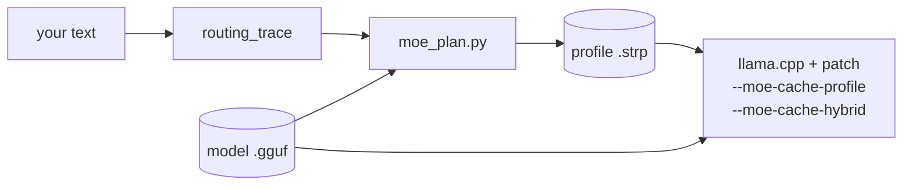
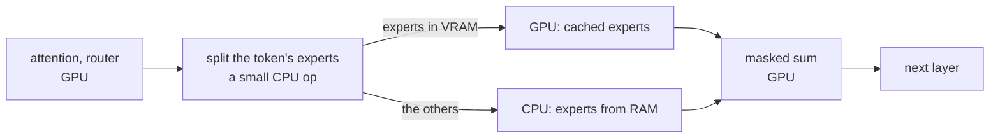

# extended-strata-moe

**Run big Mixture-of-Experts models on a small GPU: the experts your text actually uses live in VRAM, and the CPU
computes the rest from RAM in the same step.**

> **An extension of [Strata](https://github.com/Niko1221/Strata) by [Niko1221](https://github.com/Niko1221).**
> Strata runs one 125B MoE model on a 12 GB gaming GPU with a profiled tier of experts in VRAM while the CPU
> computes the rest. Its engine is built for that one model. extended-strata-moe brings the same idea to **every MoE
> model [llama.cpp](https://github.com/ggml-org/llama.cpp) runs**, as a llama.cpp patch: gpt-oss-120b, GLM-5.2,
> DeepSeek V3/V4, Kimi, Qwen3 MoE, Qwen3-Next, Llama 4, MiniMax and 45 more architectures.
> [What comes from Strata](#relation-to-strata).


```bash
llama-server -m gpt-oss-120b-MXFP4.gguf -ngl 999 -fit off --cpu-moe \
    --moe-cache-mib 4800 --moe-cache-profile gpt-oss-120b.strp --moe-cache-hybrid
```

---

## Why

A MoE model reads only a few experts per token, but which few changes from token to token, so all of them have to
be somewhere fast. On a consumer GPU most of them end up in RAM. llama.cpp's usual answer is `--n-cpu-moe N`: the
experts of whole layers go to the GPU and the rest stay on the CPU.

Routing is not uniform, though. For a given kind of text, a small set of experts takes most of the traffic: on
gpt-oss-20b, the hottest 51% of the experts served 80% of the routings on held-out text. extended-strata-moe:

1. **traces** which experts your text routes to (a few minutes on the CPU);
2. **ranks** every (layer, expert) pair and fills the VRAM you can spare with the hottest ones;
3. **splits every MoE layer at run time**: the GPU computes the token's experts it holds, the CPU computes the
   others straight from RAM, and nothing crosses PCIe during generation.

On gpt-oss-20b with 5 GB of VRAM for experts, that serves **78% of expert reads from VRAM, against 50% for the best
layer split** of the same size.

## Results

Measured on an RTX 4060 Laptop (8 GB, PCIe 4.0 x8), i7-13620H, DDR5-5200, under WSL2. Laptop thermals move the
speed by up to 25%, so every comparison is interleaved rounds. [ADR-002](docs/ADR-002-cpu-misses-not-uploads.md)
has the full tables and methods.

**Correctness.** llama.cpp's own `test-llama-archs` runs every MoE architecture on the GPU against the CPU, with 7
cache configurations: the upload cache, with and without a profile; the hybrid holding half and all of the experts;
and one-token decoding, as in generation. With F16 and with Q8_0 experts, **no cache configuration does worse than
llama.cpp without the cache on any of the 53 architectures.** Two extra checks only the cache gets: a profile must
give bit-identical logits, and the hybrid's first MoE layer must match the full cache to 1e-4. Both are seen to
fail on deliberately broken code. On real models the hybrid stays as close to the CPU reference as upstream's GPU
cache does:

| model | KL divergence vs `--cpu-moe` | same top token | upstream cache, for scale |
|---|---:|---:|---:|
| gpt-oss-20b (MXFP4) | 0.0020 | 99.0% | 0.0025 |
| Granite 3.1 1B-A400M (Q4_K_M) | 0.0059 | 95.8% | 0.0054 |

**Speed.** Generation tokens/s, 6 CPU threads (the best count for both):

| gpt-oss-20b, 5 GB of VRAM for experts | experts read from VRAM | tokens/s (3 rounds) |
|---|---:|---:|
| `--n-cpu-moe 12` (best layer split) | 50% | 28.2 / 30.2 / 28.3 |
| `--moe-cache-hybrid` | 78% | 27.7 / 28.1 / 27.5 |
| upload cache (upstream `--moe-cache-mib`) | 88% (simulated) | slowest at every size |

**Honest summary: on gpt-oss-20b the hybrid matches the best layer split; it does not beat it yet.** Every layer
that touches the CPU pays a GPU↔CPU round trip (~0.2 ms under WSL). The hybrid pays it in all 24 layers, while
the layer split pays it in 12, and the CPU and GPU halves run one after the other. On tiny experts (Granite, 0.9 MB)
the round trips cost more than the bytes saved, and the layer split wins.

**Where it should win:** large experts with few layers fitting in VRAM. On gpt-oss-120b with 8 GB, only 2-3 of the
36 layers fit, so the layer split pays 33-34 round trips anyway and its byte saving is small. That benchmark is
running; [the roadmap](#roadmap) lists what comes next.

## Quick start

Linux or WSL2, with the CUDA toolkit for a GPU build (`nvcc` on the PATH), CMake 3.14+, Python 3 with `venv`
(tested with 3.12) and git.

```bash
git clone https://github.com/<you>/extended-strata-moe && cd extended-strata-moe
bash scripts/setup.sh          # llama.cpp at a pinned commit + the patch, built; Python tools; the tracer
```

Then, for any MoE GGUF:

```bash
M=gpt-oss-120b-MXFP4.gguf      # e.g. from https://huggingface.co/ggml-org/gpt-oss-120b-GGUF
L=llama.cpp/build/bin

# 1. which experts your kind of text uses: a few thousand tokens of your chats, code or docs (CPU is enough)
build/routing_trace $M my_text.txt trace.bin 4096 8

# 2. the profile: the hottest experts that fit, the flags to use, and the layer split to compare with
.venv/bin/python tools/moe_plan.py $M --vram-gib 8 --trace trace.bin --out model.strp

# 3. run it with the flags the planner printed
$L/llama-server -m $M -ngl 999 -fit off --cpu-moe --moe-cache-mib 4800 \
    --moe-cache-profile model.strp --moe-cache-hybrid -t 6 --metrics

# 4. measure it against the layer split on your machine, at a few thread counts
.venv/bin/python tools/bench_cache.py $M my_text.txt --profile model.strp --cache-mib 4800 \
    --n-cpu-moe 33 --hybrid --only-hybrid -t 4 6 8
```

Keep whichever is faster. [docs/guide.md](docs/guide.md) walks through each step, with sizing for 8-24 GB GPUs,
thread counts and troubleshooting.

**Windows:** the patch is plain llama.cpp code; build it like llama.cpp
([steps in the guide](docs/guide.md#windows)). A native Windows build has not been benchmarked yet.

## What you get

| | |
|---|---|
| `--moe-cache-hybrid` | per-expert VRAM residency; the CPU computes the misses, nothing is uploaded |
| `--moe-cache-profile FILE` | fills the MoE cache at load from a profile, hottest experts first (also helps upstream's upload cache) |
| `--moe-cache-audit FILE` | a JSONL audit trail: the model, the flags, the profile's SHA-256 and the resident experts at load; one record per server request; the counters at exit |
| `/metrics` | hits, misses, CPU and PCIe bytes, slots and per-layer series for Prometheus (`llama-server --metrics`) |
| `tools/monitor.html` | a live dashboard of those metrics |
| `tools/moe_plan.py` | reads any MoE GGUF (split files too), mirrors llama.cpp's cache arithmetic, writes the profile, prints the flags |
| `tools/routing_trace` | records which experts a model routes on your text |
| `tools/sim_cache.py` | replays held-out text through every placement policy at llama.cpp's exact slot counts |
| `tools/bench_cache.py` | interleaved speed comparison of the placements |

Everything is in [docs/reference.md](docs/reference.md): flags, C API, metrics, the audit record schema and the
file formats.

## Supported models

Every MoE architecture in llama.cpp goes through one function (`build_moe_ffn`) and one cache, so the patch covers
all of them. Tested with llama.cpp's `test-llama-archs` on the GPU:

| architecture | models |
|---|---|
| `gpt-oss` | gpt-oss-20b, gpt-oss-120b |
| `glm4moe`, `glm-dsa`, `glm5-next` | GLM-4.5 / 4.6 / 4.5-Air, GLM-5.2, GLM-5.3-Flash |
| `deepseek2`, `deepseek32`, `deepseek4`, `kimi-k3` | DeepSeek V2 / V3 / R1, V3.2, V4, Kimi K2 / K3 |
| `qwen2moe`, `qwen3moe`, `qwen3next`, `qwen35moe`, `qwen3vlmoe` | Qwen1.5/2 MoE, Qwen3-30B-A3B / 235B-A22B, Qwen3-Next, Qwen3.5 MoE, Qwen3-VL MoE |
| `llama4`, `llama` | Llama 4 Scout / Maverick, Mixtral |
| `minimax-m2`, `minimax-m3`, `minimax-01` | MiniMax M2, M3, MiniMax-01 |
| `granitemoe`, `olmoe`, `phimoe`, `dbrx`, `arctic`, `grok` | Granite MoE, OLMoE, Phi-3.5-MoE, DBRX, Snowflake Arctic, Grok |
| `dots1`, `ernie4_5-moe`, `hunyuan-moe`, `bailingmoe*`, `lfm2moe`, `smallthinker`, ... | dots.llm1, ERNIE 4.5 MoE, Hunyuan, Ling, LFM2 MoE, SmallThinker, ... |

<details>
<summary>All 53 MoE architectures</summary>

afmoe, arctic, bailingmoe, bailingmoe2, bailingmoe3, cohere2moe, dbrx, deepseek, deepseek2, deepseek32, deepseek4,
dots1, dots3note, ernie4_5-moe, exaone-moe, glm-dsa, glm4moe, glm5-next, gpt-oss, granite, granitemoe, grok,
grovemoe, hunyuan-moe, hy_v3, hy_v4, k2-horizon, kimi-k3, kimi-linear, laguna, lfm2moe, llada-moe, llama, llama4,
maple, mellum, mimo2, minicpm, minimax-01, minimax-m2, minimax-m3, mistral3, mistral4, olmoe, phimoe, qwen2moe,
qwen35moe, qwen3moe, qwen3next, qwen3vlmoe, qwen4exp, rnd1, smallthinker

</details>

**When it helps:** large experts (MXFP4 / Q4 models of 20B+ parameters), skewed routing, and a model that is much
bigger than your VRAM. **When it doesn't:** tiny experts (round trips dominate), near-uniform routing (Mixtral's 8
experts top-2 has no "hot few"), or a model that fits in VRAM anyway.

## How it works



At load, the cache fills the VRAM budget with the profile's hottest experts and never changes them. Each MoE layer
of each generated token then runs like this:



- Layers whose experts are all cached skip the CPU entirely.
- The CPU's `mul_mat_id` and CUDA's one-token `mul_mat_vec_q` skip the rows the other side owns, so neither reads
  an expert it does not compute.
- Prompt processing (batches over 32 tokens) keeps llama.cpp's own path.

The design and the measurements behind it: [ADR-001](docs/ADR-001-generic-moe-expert-tiering.md) (why a llama.cpp
patch, not a port of Strata's engine) and [ADR-002](docs/ADR-002-cpu-misses-not-uploads.md) (why misses go to the
CPU, not over PCIe).

### Compared with what llama.cpp has

| | `--n-cpu-moe N` | upstream `--moe-cache-mib` | extended-strata-moe `--moe-cache-hybrid` |
|---|---|---|---|
| what is in VRAM | every expert of the last layers | the most recently used experts | the experts your text uses most, from a profile |
| a miss | computed on the CPU | uploaded over PCIe, then the GPU | computed on the CPU |
| GPU↔CPU round trips per token | one per CPU layer | none | one per layer not held whole |
| best when | experts are small | PCIe is fast, misses are rare | experts are large, routing is skewed |

## Watch it live

```bash
llama-server -m $M ... --moe-cache-hybrid --metrics
python3 -m http.server -d tools 8090     # llama-server answers localhost origins, so not file://
# open http://127.0.0.1:8090/monitor.html?server=http://127.0.0.1:8080
```

The dashboard shows generation speed, the hit rate (per interval and overall), the share of hits from the profile,
CPU and upload bandwidth, and a per-layer chart. llama-server also logs one line per request:

```
MoE cache hits =    52.69 % (hybrid: 3455 on the GPU, 3102 on the CPU, which read 39106.3 MiB)
```

(gpt-oss-20b, one 64-token answer about the sky with a profile traced on llama.cpp's docs: text unlike the
profile's gets fewer hits than the 78% of the benchmark above.)

## Audit trail

`--moe-cache-audit run.jsonl` appends one JSON object per line, so any number in a benchmark or a bug report can be
traced to the exact model, flags, profile and resident experts that produced it. The same gpt-oss-20b request,
trimmed (the counters of every record and the long lists cut):

```json
{"event":"load","time":"2026-10-09T13:57:01Z","hybrid":true,"hits":0,"misses":0,...,
 "model":{"path":".../gpt-oss-20b-MXFP4.gguf","bytes":12109566624,"name":"gpt-oss-20b","n_layer":24},
 "params":{"build":"b1-de7fa0a","moe_cache_mib":5000,"moe_cache_hybrid":true,"n_threads":6,...,
           "tensor_overrides":["\\.ffn_(up|down|gate|gate_up)_(ch|)exps"]},
 "cache":{"slots":395,"prefilled":395,"bytes":5234803584},
 "profile":{"path":"build/gptoss/profile.strp","bytes":6168,"sha256":"4930970ebc986d01e6fd48beb3a7ff7a4c4c977ef2f077345afb38eaee178d73"},
 "layers":[{"il":0,"slots":395,"hits":0,"misses":0,"resident":[1,3,5,6,8,...]},...]}
{"event":"ready","time":"2026-10-09T13:57:02Z","hits":202,"misses":108,"bytes_cpu":1427673600,...}
{"event":"request","time":"2026-10-09T13:57:15Z","task":0,"n_prompt":10,"n_gen":64,"t_gen_ms":11300.674,
 "req_hits":3455,"req_misses":3102,"req_bytes_upload":0,"req_bytes_cpu":41005958400,...}
{"event":"exit","time":"2026-10-09T13:57:15Z","hits":3657,"misses":3210,...,"layers":[...]}
```

The `ready` record holds what llama-server decoded at load (its warmup and a context probe), so the `request`
records add up exactly to `exit` minus `ready`.

`tools/check_audit.py` checks that a log holds together: the SHA-256 is the file's, the resident experts add up to
the prefilled slots, and the per-request counters add up to the totals. The schema is in
[docs/reference.md](docs/reference.md#audit-log).

## FAQ

**Does it change the model's output?** It computes the same experts with the same weights; only the summation order
of the GPU and CPU parts differs. The KL divergence above is in the range of llama.cpp's own GPU-vs-CPU differences.

**Do I need a new profile per model?** Per model, and ideally per kind of text (chat, code, another language).
Tracing a few thousand tokens takes minutes on the CPU. A profile from different text still works, with fewer hits.

**How much VRAM should the cache get?** Whatever the dense weights, KV cache and compute buffers leave.
`moe_plan.py --vram-gib N` works it out; `--reserve-gib` (default 2) is the headroom.

**AMD / ROCm, Metal, Vulkan?** The hybrid works on every backend. The one-token fast path (skipping the CPU's rows
on the GPU) is enabled for CUDA and ROCm; ROCm is untested. Other backends use a slower stand-in path.

**Is it in upstream llama.cpp?** Not yet. It is a patch against a pinned commit (`patches/BASE`), applied by
`scripts/setup.sh`.

## Roadmap

- [ ] gpt-oss-120b benchmark (in progress) and native Windows numbers
- [ ] overlap the CPU and GPU halves of a layer (Strata does; the main remaining cost)
- [ ] heat-based swapping during a chat (Strata's adaptive tier, [ADR-001](docs/ADR-001-generic-moe-expert-tiering.md) step 3)
- [ ] upstream the patch to llama.cpp

## Contributing

Benchmarks from other GPUs are the most useful contribution right now: there is an issue template for them.
[CONTRIBUTING.md](CONTRIBUTING.md) explains the checks (`tools/check_all.sh`) and how the patch is maintained.

## Relation to Strata

[Strata](https://github.com/Niko1221/Strata), by Niko1221, is where the idea comes from. It is an inference engine
for one model, Qwen3.8-Flash-Next (125B, 48 layers x 512 experts), on a 12 GB GPU, with hand-written kernels for
that architecture. extended-strata-moe takes Strata's design to every MoE model llama.cpp loads:

| Strata | in extended-strata-moe |
|---|---|
| a tier of experts in VRAM, ranked by measured routing frequency | yes: `tools/moe_plan.py` + `--moe-cache-profile` |
| the CPU computes the experts the tier misses, in place; a miss never waits for PCIe | yes: `--moe-cache-hybrid` |
| the `STRP` profile and `--dump-routing` trace formats | yes, the same formats (`tools/routing_trace` writes Strata's trace layout) |
| CPU and GPU expert work overlapped | not yet (the roadmap's main item) |
| adaptive swaps by routing heat during a chat | not yet |
| speculative decoding from the model's MTP head; expert streaming on the prompt path | no (llama.cpp has its own speculative decoding) |

No Strata code is included: Strata's engine is built around its one model's geometry, so this project builds on
llama.cpp's MoE cache instead ([ADR-001](docs/ADR-001-generic-moe-expert-tiering.md) explains the choice). If you
run Strata's model, use Strata.

## Credits

- [Strata](https://github.com/Niko1221/Strata) by [Niko1221](https://github.com/Niko1221): the expert-tiering
  design, and the `STRP` profile and routing-trace formats.
- [llama.cpp](https://github.com/ggml-org/llama.cpp): the engine, its MoE cache (`--moe-cache-mib`) and its test
  suite.

MIT licensed, like llama.cpp. See [LICENSE](LICENSE).
