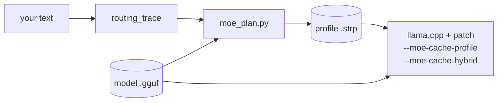
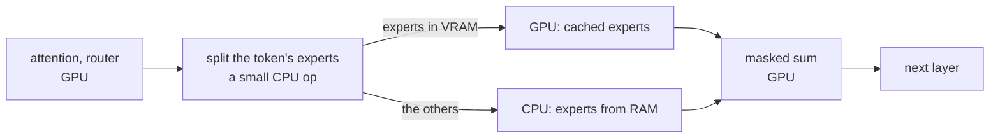
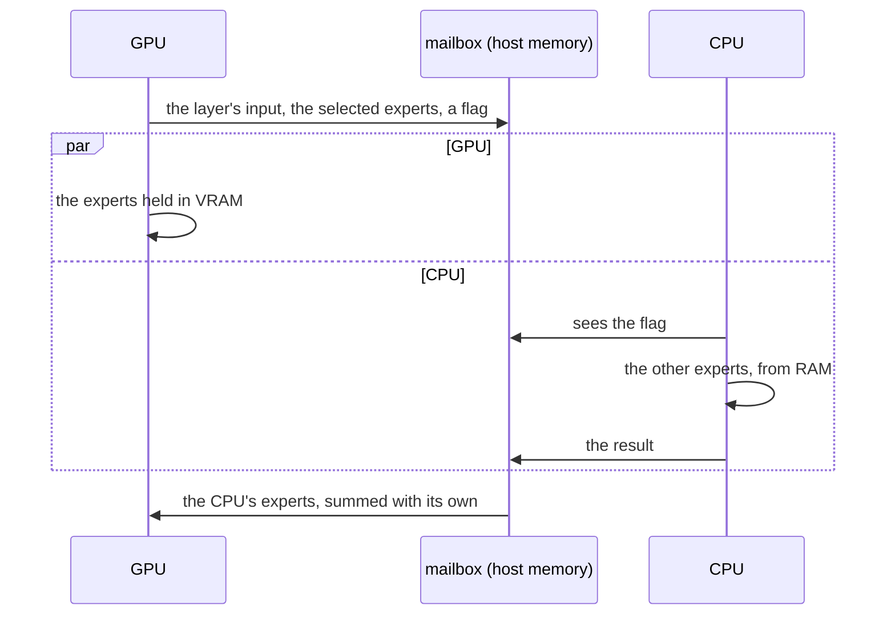

# extended-strata-moe

**Run big Mixture-of-Experts models on a small GPU: the experts your text actually uses live in VRAM, and the CPU
computes the rest from RAM in the same step.**

> **An extension of [Strata](https://github.com/Niko1221/Strata) by [Niko1221](https://github.com/Niko1221).**
> Strata runs one 125B MoE model on a 12 GB gaming GPU with a profiled tier of experts in VRAM while the CPU
> computes the rest. Its engine is built for that one model. extended-strata-moe brings the same idea to **every MoE
> model [llama.cpp](https://github.com/ggml-org/llama.cpp) runs**, as a llama.cpp patch: gpt-oss-120b, GLM-5.2,
> DeepSeek V3/V4, Kimi, Qwen3 MoE, Qwen3-Next, Llama 4, MiniMax and 45 more architectures.
> [What comes from Strata](#relation-to-strata).


**gpt-oss-120b (63 GB) on an 8 GB laptop GPU: 27 tokens/s with no profile and no tuning, 69% faster than llama.cpp's
best layer split (77% with a profile made from your kind of text); prompts 4x faster** ([results](#results)).

```bash
python tools/serve.py gpt-oss-120b-MXFP4.gguf
```

It sizes the expert cache to your GPU, lets the cache learn which experts your conversation uses, and serves the model on
an **OpenAI-compatible and an Anthropic-compatible API**, so your chat apps, coding agents and SDKs (Claude Code
included) connect with a base URL and a key: [connect your tools](docs/connect.md).

---

## In plain words

A Mixture-of-Experts (MoE) model is a huge model made of many small specialists ("experts"). For each word it writes,
it consults only a few of them. The catch is that you cannot know which few, so every expert must be somewhere fast.
A 60 GB model does not fit on an 8 GB graphics card, so most experts live in the computer's RAM.

The usual workaround (`--n-cpu-moe`) puts *whole layers* of experts on the card and leaves the rest in RAM. This
project watches which experts **your** text actually uses, keeps the most used ones on the card (and swaps in the ones
your conversation turns to), and lets the processor compute the others straight from RAM. The same experts are
computed with the same weights, only where they run changes, so the answers are the same up to rounding
([how close](#results)).

**Is it for you?**

| you have | use it? |
|---|---|
| a MoE model bigger than your GPU's memory (gpt-oss, GLM, DeepSeek, Qwen3, Kimi, ...), an NVIDIA card, and enough RAM for the whole model | **yes** |
| a model that fits in your GPU's memory | no, plain llama.cpp is faster |
| a dense (non-MoE) model such as Llama 3 or Gemma | no, nothing to cache |
| a MoE model whose routing is almost uniform (Mixtral: 8 experts, top 2) | probably not: there is no "hot few" to keep |

## Why

A MoE model reads only a few experts per token, but which few changes from token to token, so all of them have to
be somewhere fast. On a consumer GPU most of them end up in RAM. llama.cpp's usual answer is `--n-cpu-moe N`: the
experts of whole layers go to the GPU and the rest stay on the CPU.

Routing is not uniform, though. For a given kind of text, a small set of experts takes most of the traffic: on
gpt-oss-20b, the hottest 51% of the experts served 80% of the routings on held-out text. extended-strata-moe:

1. **splits every MoE layer at run time**: the GPU computes the token's experts it holds, the CPU computes the
   others straight from RAM, and nothing crosses PCIe during generation;
2. **follows the conversation**: it counts the experts the router picks and, every few dozen tokens, swaps the hottest
   ones into VRAM for the coldest it holds. It needs no setup: it starts empty and fills itself;
3. **optionally starts warm**: trace your kind of text once (a few minutes on the CPU), rank every (layer, expert) pair,
   and fill the VRAM you can spare with the hottest ones before the first token.

On gpt-oss-20b with 5 GB of VRAM for experts, a profile of held-out text serves **80% of expert reads from VRAM
(simulated), against 50% for the best layer split** of the same size.

## Results

Measured on an RTX 4060 Laptop (8 GB, PCIe 4.0 x8), i7-13620H, DDR5-5200, under WSL2. Laptop thermals move the
speed by up to 25%, so every comparison is interleaved rounds. [ADR-002](docs/ADR-002-cpu-misses-not-uploads.md)
has the full tables and methods.

**Correctness.** llama.cpp's own `test-llama-archs` runs every MoE architecture on the GPU against the CPU, with 8
cache configurations: the upload cache, with and without a profile; the hybrid holding half and all of the experts;
one-token decoding, as in generation; and the adaptive cache, which swaps experts in between chunks of tokens (and
fails if it does not swap when it should). With F16 and with Q8_0 experts, **no cache configuration does worse than
llama.cpp without the cache on any of the 53 architectures.** Two extra checks only the cache gets: a profile must
give bit-identical logits, and the hybrid's first MoE layer must match the full cache to 1e-4. Both are seen to
fail on deliberately broken code. The one-token configs run through the mailbox, and `check_audit.py` checks that a
generation with the mailbox is word for word the one without (it fails when the mailbox is made to return zeros). On
real models the hybrid stays as close to the CPU reference as upstream's GPU cache does:

| model | KL divergence vs `--cpu-moe` | same top token | upstream cache, for scale |
|---|---:|---:|---:|
| gpt-oss-20b (MXFP4) | 0.0020 | 99.0% | 0.0025 |
| Granite 3.1 1B-A400M (Q4_K_M) | 0.0059 | 95.8% | 0.0054 |

**Generation speed.** 10 CPU threads (the best count for these configs, from sweeps), interleaved rounds (round 1 of
every config, then round 2, and so on), the average of 3. Each run generates 400 tokens from a cold start, so the
adaptive rows include their own learning: the cache fills while it answers. Compare numbers inside a table only: the
laptop's absolute speed differs from one session to the next.

| gpt-oss-120b (63 GB), 5 GB of VRAM for experts | tokens/s | expert reads served from VRAM | vs the best layer split |
|---|---:|---:|---:|
| llama.cpp `--cpu-moe` (no expert on the GPU) | 14.5 | 0% | |
| llama.cpp `--n-cpu-moe 33` (the best layer split) | 15.9 | 8% | |
| fixed cache, profile made from other text | 22.5 | 21% | +41% |
| fixed cache, profile made from text like the prompt | 26.0 | 35% | +64% |
| **adaptive cache, no profile** | **26.9** | 45% | **+69%** |
| adaptive cache, profile made from other text | 24.8 | 34% | +56% |
| adaptive cache, profile made from text like the prompt | **28.2** | 46% | **+77%** |

| gpt-oss-20b (12 GB), 5 GB of VRAM for experts | tokens/s | expert reads served from VRAM | vs the best layer split |
|---|---:|---:|---:|
| llama.cpp `--cpu-moe` (no expert on the GPU) | 22.8 | 0% | |
| llama.cpp `--n-cpu-moe 12` (the best layer split) | 38.7 | 50% | |
| fixed cache, profile made from other text | 60.5 | 81% | +56% |
| fixed cache, profile made from text like the prompt | 62.0 | 84% | +60% |
| adaptive cache, no profile | 54.6 | 82% | +41% |
| adaptive cache, profile made from other text | 57.0 | 82% | +47% |
| adaptive cache, profile made from text like the prompt | 60.5 | 86% | +56% |

**Longer replies** (one run each, the same prompt). The fixed cache's hit rate falls as the generated text drifts away from
its profile; the adaptive cache's does not, and its learning cost is spent once.

| tokens generated | gpt-oss-120b: fixed cache, profile from other text | adaptive, no profile | adaptive, profile from other text | adaptive, profile from like text |
|---:|---:|---:|---:|---:|
| 400 (the average above) | 22.5 | 26.9 | 24.8 | 28.2 |
| 1,500 | 20.7 | **27.9** | 23.2 | **28.8** |

| tokens generated | gpt-oss-20b: fixed, other-text profile | fixed, like-text profile | adaptive, no profile | adaptive, other-text profile | adaptive, like-text profile |
|---:|---:|---:|---:|---:|---:|
| 400 (the average above) | 60.5 | 62.0 | 54.6 | 57.0 | 60.5 |
| 1,500 | 53.6 | 55.2 | 56.5 | 58.6 | **60.7** |
| 3,000 | 52.4 | 51.4 | 56.1 | 58.8 | **65.2** |

**A coding model.** Qwen3-Coder-Next 80B-A3B (Q6_K, 65.6 GB, 3B active; 3 GB of VRAM for experts at a 4,096 context), same
method, no profile:

| Qwen3-Coder-Next 80B, Q6_K | tokens/s | lookups that hit | vs the best layer split |
|---|---:|---:|---:|
| llama.cpp `--cpu-moe` | 16.7 | 0% | |
| llama.cpp `--n-cpu-moe 46` (the best layer split) | 17.8 | 0% | |
| **adaptive cache, no profile** | **30.9** | 52% | **+74%** |
| the same, 1,500 tokens (one run) | 29.5 | 47% | |
| later, with `serve.py --favor generation` (4.6 GB of cache), staged swaps and chunked CPU experts: 300 tokens from cold | 29.4 | | |
| the same, **1,200 tokens** (the cache has learned; a server keeps it between requests) | **37.2** | 50-83% a layer | **+109%** |

It also passed 6 of 6 small Python tasks (`tools/code_eval.py`: merge intervals, LRU cache, bracket matching, top-k words, Roman
numerals, key=value parsing; each answer run against asserts) through the server, at 14 to 24 tokens/s including prompt time.
A harder ten-task suite (`code_eval.py --suite hard`: shortest paths, an expression parser, topological sort, glob matching, a
bug fix, text justification, a rate limiter, CSV parsing, island counting, a retry decorator) passed 8 of 10: the island counter
used a recursive search that overflows the stack on a 300 x 300 grid, and the calculator got unary minus wrong (`-2+3` gave -5).
That is a smoke test, not a benchmark.

Strata's own model (Qwen3.8-Flash-Next 125B, IQ3_XXS, 75.8 GB) also loads in this patch's llama.cpp, but runs slower here
than in Strata: 8.6 to 11.4 tokens/s with a 1.5 GB expert cache, against the 20-25 Strata gives on the same machine
([ADR-002](docs/ADR-002-cpu-misses-not-uploads.md) has the setup and the likely causes).

**Prompt speed.** Every batch of a prompt uploads the experts over PCIe, so a bigger batch is a faster prompt, at the price
of VRAM the expert cache would use. gpt-oss-120b, a 2,764-token prompt, fixed cache; `serve.py` fits the cache to what is left:

| batch size (`--ubatch`) | expert cache that fits | prompt | generation |
|---:|---:|---:|---:|
| 512 (llama.cpp's default) | 4,973 MiB | 96 tokens/s | 24.1 tokens/s |
| 2,048 | 3,863 MiB | **241** | 24.8 |
| 4,096 | 2,105 MiB | **397** | 21.9 |

**What this says.** Three things add up.

1. The GPU and the CPU work on a layer *at the same time*, handing data over in 3 µs through shared memory
   ([how](#how-it-works)): 17.2 to 21.3 tokens/s on its own, on the 120b.
2. Which experts sit in VRAM decides the rest. With 8 GB the card holds 8% of the 120b's experts, so what they are
   matters. A fixed cache serves 21% of the reads from a profile of other text and 35% from one made from the prompt's
   kind of text. The adaptive cache, with no profile at all, reaches 45% and is faster than both (26.9 tokens/s against
   22.5 and 26.0), and at 1,500 tokens it runs 27.9 against the fixed cache's 20.7. It needs a few hundred tokens to
   fill, which the 400-token runs include. A profile made from other text is no help to it: it fills the cache with
   experts the conversation does not use, and the adaptive cache replaces them slowly (24.8 tokens/s against 26.9 with
   no profile on the 120b; on the 20b the same start is ahead of no profile).
3. The cost is the copies. A swap moves 13 MB over PCIe, 1.2 ms. On the 20b, whose cache already holds 51% of the
   experts, a fixed profile is near the limit and the adaptive cache's first few hundred swaps cost 2 to 12% on a
   400-token reply; by 1,500 tokens it is ahead, and at 3,000 tokens it is 7 to 27% faster.

The batch size decides the prompt speed. The GPU's share of the work is limited by its memory: the CPU still computes more
than half of the experts of every token. Even a model with tiny experts gains (Granite 1B, 0.9 MB, forced to run from
RAM: 248 tokens/s against 160 for the best layer split; it lost to the layer split before the mailbox). How the time is
spent, token by token: [ADR-002](docs/ADR-002-cpu-misses-not-uploads.md).

## Quick start

Linux or WSL2, with the CUDA toolkit for a GPU build (`nvcc` on the PATH), CMake 3.14+, Python 3 with `venv`
(tested with 3.12) and git.

```bash
git clone https://github.com/<you>/extended-strata-moe && cd extended-strata-moe
bash scripts/setup.sh          # llama.cpp at a pinned commit + the patch, built; Python tools; the tracer
```

Then, for any MoE GGUF (the example is gpt-oss-120b on an 8 GB card):

```bash
M=gpt-oss-120b-MXFP4.gguf      # e.g. from https://huggingface.co/ggml-org/gpt-oss-120b-GGUF

# 1. Serve: sizes the expert cache to your GPU, then OpenAI + Anthropic API on http://127.0.0.1:8080
#    The cache starts empty and fills itself with the experts your conversation uses.
.venv/bin/python tools/serve.py $M --api-key my-secret-key

# 2. Optional, to start warm: which experts does YOUR kind of text use? Text like what you will run (chats, code, docs
#    in your language), a few thousand tokens. The model runs on the CPU for a while (about 18 minutes for 15,000
#    tokens of gpt-oss-120b). Then serve with it:
.venv/bin/python tools/make_profile.py $M my_text.txt -o model.strp
.venv/bin/python tools/serve.py $M --profile model.strp --api-key my-secret-key

# 3. Measure it against the layer split on your machine, at a few thread counts (the speed depends on the CPU)
.venv/bin/python tools/bench_cache.py $M my_text.txt --profile model.strp --cache-mib 3240 \
    --n-cpu-moe 34 --hybrid --adaptive -t 6 8 10 -n 400   # 3240 MiB = 2 layers' experts: the layer split to compare with is 34
```

A profile matters less than it did: the cache follows the conversation and works without one. One made from text like
yours gives the first replies a head start; one made from other text can be worse than none (see [Results](#results)).
[docs/guide.md](docs/guide.md) walks through each step (the planner's report, sizing for 8-24 GB GPUs, thread counts and
troubleshooting).

### Use it from your tools (OpenAI and Claude)

`llama-server` speaks both APIs on the one port. Step 2 prints the settings; they are:

| your tool | set |
|---|---|
| OpenAI SDKs, chat apps, coding agents with an "OpenAI-compatible" provider | `OPENAI_BASE_URL=http://127.0.0.1:8080/v1`, `OPENAI_API_KEY=my-secret-key` |
| Claude Code, the Anthropic SDKs | `ANTHROPIC_BASE_URL=http://127.0.0.1:8080`, `ANTHROPIC_AUTH_TOKEN=my-secret-key`, `ANTHROPIC_MODEL=gpt-oss-120b-MXFP4` |
| a browser | open `http://127.0.0.1:8080` |

[docs/connect.md](docs/connect.md) has the Python snippets, the notes (context size, long prompts, security) and the
list of endpoints. `tools/check_api.py` tests them with the hybrid on: OpenAI chat (plain and streamed), the Responses
API, Anthropic messages (plain and streamed), token counting, and the API key.

**Windows:** the patch is plain llama.cpp code; build it like llama.cpp
([steps in the guide](docs/guide.md#windows)). A native Windows build has not been benchmarked yet.

## What you get

| | |
|---|---|
| `--moe-cache-hybrid` | per-expert VRAM residency; the CPU computes the misses, nothing is uploaded |
| `--moe-cache-adaptive` | the cache follows the conversation: it swaps the experts the router picks most into VRAM while generating, so it needs no profile |
| `--moe-cache-profile FILE` | fills the MoE cache at load from a profile, hottest experts first (also helps upstream's upload cache) |
| `--moe-cache-audit FILE` | a JSONL audit trail: the model, the flags, the profile's SHA-256 and the resident experts at load; one record per server request; the counters at exit |
| the mailbox | under CUDA, the GPU and the CPU work on a layer at once and hand data over through shared memory in 3 µs (`LLAMA_MOE_CACHE_NO_MAILBOX=1` turns it off) |
| `tools/serve.py` | starts the server with the adaptive hybrid, the cache and the batch size fitted to your GPU by measurement, and prints the settings for OpenAI-compatible tools and Claude Code ([connect your tools](docs/connect.md)) |
| `tools/make_profile.py` | the profile for your text in one command |
| `/metrics` | hits, misses, CPU and PCIe bytes, slots and per-layer series for Prometheus (`llama-server --metrics`) |
| `tools/monitor.html` | a live dashboard of those metrics |
| `tools/moe_plan.py` | reads any MoE GGUF (split files too), mirrors llama.cpp's cache arithmetic, writes the profile, prints the flags |
| `tools/routing_trace` | records which experts a model routes on your text |
| `tools/sim_cache.py` | replays held-out text through every placement policy at llama.cpp's exact slot counts |
| `tools/bench_cache.py` | interleaved speed comparison of the placements |

Everything is in [docs/reference.md](docs/reference.md): flags, C API, metrics, the audit record schema and the
file formats.

## Supported models

Every MoE architecture in llama.cpp goes through one function (`build_moe_ffn`) and one cache, so the patch covers
all of them. Tested with llama.cpp's `test-llama-archs` on the GPU:

| architecture | models |
|---|---|
| `gpt-oss` | gpt-oss-20b, gpt-oss-120b |
| `glm4moe`, `glm-dsa`, `glm5-next` | GLM-4.5 / 4.6 / 4.5-Air, GLM-5.2, GLM-5.3-Flash |
| `deepseek2`, `deepseek32`, `deepseek4`, `kimi-k3` | DeepSeek V2 / V3 / R1, V3.2, V4, Kimi K2 / K3 |
| `qwen2moe`, `qwen3moe`, `qwen3next`, `qwen35moe`, `qwen3vlmoe` | Qwen1.5/2 MoE, Qwen3-30B-A3B / 235B-A22B, Qwen3-Next, Qwen3.5 MoE, Qwen3-VL MoE |
| `llama4`, `llama` | Llama 4 Scout / Maverick, Mixtral |
| `minimax-m2`, `minimax-m3`, `minimax-01` | MiniMax M2, M3, MiniMax-01 |
| `granitemoe`, `olmoe`, `phimoe`, `dbrx`, `arctic`, `grok` | Granite MoE, OLMoE, Phi-3.5-MoE, DBRX, Snowflake Arctic, Grok |
| `dots1`, `ernie4_5-moe`, `hunyuan-moe`, `bailingmoe*`, `lfm2moe`, `smallthinker`, ... | dots.llm1, ERNIE 4.5 MoE, Hunyuan, Ling, LFM2 MoE, SmallThinker, ... |

<details>
<summary>All 53 MoE architectures</summary>

afmoe, arctic, bailingmoe, bailingmoe2, bailingmoe3, cohere2moe, dbrx, deepseek, deepseek2, deepseek32, deepseek4,
dots1, dots3note, ernie4_5-moe, exaone-moe, glm-dsa, glm4moe, glm5-next, gpt-oss, granite, granitemoe, grok,
grovemoe, hunyuan-moe, hy_v3, hy_v4, k2-horizon, kimi-k3, kimi-linear, laguna, lfm2moe, llada-moe, llama, llama4,
maple, mellum, mimo2, minicpm, minimax-01, minimax-m2, minimax-m3, mistral3, mistral4, olmoe, phimoe, qwen2moe,
qwen35moe, qwen3moe, qwen3next, qwen3vlmoe, qwen4exp, rnd1, smallthinker

</details>

**When it helps:** a model much bigger than your VRAM, whose routing is skewed (a "hot few" for your kind of text), on an
NVIDIA card (the GPU-and-CPU overlap is CUDA). **When it doesn't:** near-uniform routing (Mixtral's 8 experts, top 2),
or a model that fits in VRAM anyway. On AMD or other GPUs the hybrid still runs, without the overlap.

## How it works



At load, the cache fills the VRAM budget with the profile's hottest experts (without a profile it starts empty). Each MoE
layer of each generated token then runs like this:



- Layers whose experts are all cached skip the CPU entirely.
- The CPU's `mul_mat_id` and CUDA's one-token `mul_mat_vec_q` skip the rows the other side owns, so neither reads
  an expert it does not compute.
- Prompt processing (batches over 32 tokens) keeps llama.cpp's own path.

**The GPU and the CPU work at the same time.** Handing a layer from one to the other through llama.cpp's scheduler costs
two to five synchronous copies and a stream synchronization, 130 to 180 µs per layer under WSL2, and the GPU's part ran
after the CPU's. With CUDA, one token at a time, the hybrid uses a *mailbox* instead: page-locked host memory the GPU writes
and the CPU polls (a hand-over measures 3 µs, against 50 to 180 µs):



On gpt-oss-120b this alone took generation from 17.2 to 21.3 tokens/s ([ADR-002](docs/ADR-002-cpu-misses-not-uploads.md)).

**The cache follows the conversation.** The hybrid counts the experts the router picks (a heat per layer and expert,
fading with a half-life of about 350 tokens). Every 32 generated tokens, between two tokens while the GPU is idle,
it copies the hottest experts the cache lacks into the slots of the coldest ones it holds (at most 64: 1.2 ms each on
gpt-oss-120b), if they are clearly hotter. With no profile the cache starts empty and fills itself the same way, every 8
tokens. [Details](docs/reference.md#the-adaptive-cache).

The design and the measurements behind it: [ADR-001](docs/ADR-001-generic-moe-expert-tiering.md) (why a llama.cpp
patch, not a port of Strata's engine) and [ADR-002](docs/ADR-002-cpu-misses-not-uploads.md) (why misses go to the
CPU, not over PCIe).

### Compared with what llama.cpp has

| | `--n-cpu-moe N` | upstream `--moe-cache-mib` | extended-strata-moe `--moe-cache-hybrid` |
|---|---|---|---|
| what is in VRAM | every expert of the last layers | the most recently used experts | the experts your text uses most: a profile's, then the conversation's (`--moe-cache-adaptive`) |
| a miss | computed on the CPU | uploaded over PCIe, then the GPU | computed on the CPU |
| GPU↔CPU round trips per token | one per CPU layer | none | one per layer not held whole |
| best when | experts are small | PCIe is fast, misses are rare | experts are large, routing is skewed |

## Watch it live

```bash
llama-server -m $M ... --moe-cache-hybrid --metrics
python3 -m http.server -d tools 8090     # llama-server answers localhost origins, so not file://
# open http://127.0.0.1:8090/monitor.html?server=http://127.0.0.1:8080
```

The dashboard shows generation speed, the hit rate (per interval and overall), the share of hits from the profile,
CPU and upload bandwidth, and a per-layer chart. llama-server also logs one line per request:

```
MoE cache hits =    52.69 % (hybrid: 3455 on the GPU, 3102 on the CPU, which read 39106.3 MiB)
```

(gpt-oss-20b, one 64-token answer about the sky with a profile traced on llama.cpp's docs: text unlike the
profile's gets fewer hits than the 80% simulated above.)

## Audit trail

`--moe-cache-audit run.jsonl` appends one JSON object per line, so any number in a benchmark or a bug report can be
traced to the exact model, flags, profile and resident experts that produced it. The same gpt-oss-20b request,
trimmed (the counters of every record and the long lists cut):

```json
{"event":"load","time":"2026-10-09T13:57:01Z","hybrid":true,"hits":0,"misses":0,...,
 "model":{"path":".../gpt-oss-20b-MXFP4.gguf","bytes":12109566624,"name":"gpt-oss-20b","n_layer":24},
 "params":{"build":"b1-de7fa0a","moe_cache_mib":5000,"moe_cache_hybrid":true,"n_threads":6,...,
           "tensor_overrides":["\\.ffn_(up|down|gate|gate_up)_(ch|)exps"]},
 "cache":{"slots":395,"prefilled":395,"bytes":5234803584},
 "profile":{"path":"build/gptoss/profile.strp","bytes":6168,"sha256":"4930970ebc986d01e6fd48beb3a7ff7a4c4c977ef2f077345afb38eaee178d73"},
 "layers":[{"il":0,"slots":395,"hits":0,"misses":0,"resident":[1,3,5,6,8,...]},...]}
{"event":"ready","time":"2026-10-09T13:57:02Z","hits":202,"misses":108,"bytes_cpu":1427673600,...}
{"event":"request","time":"2026-10-09T13:57:15Z","task":0,"n_prompt":10,"n_gen":64,"t_gen_ms":11300.674,
 "req_hits":3455,"req_misses":3102,"req_bytes_upload":0,"req_bytes_cpu":41005958400,...}
{"event":"exit","time":"2026-10-09T13:57:15Z","hits":3657,"misses":3210,...,"layers":[...]}
```

(That run predates some fields: records now also carry `pid` and millisecond times, the load record the load time
and the GPUs, and the exit record the run's throughput, `perf`. It works in every tool, not only the server:
[the schema](docs/reference.md#audit-log).)

The `ready` record holds what llama-server decoded at load (its warmup and a context probe), so the `request`
records add up exactly to `exit` minus `ready`.

`tools/check_audit.py` checks that a log holds together: the SHA-256 is the file's, the resident experts add up to
the prefilled slots, and the per-request counters add up to the totals. The schema is in
[docs/reference.md](docs/reference.md#audit-log).

## Words used here

| word | meaning |
|---|---|
| expert | one of the small specialist networks inside a MoE layer; a token uses a few of them (gpt-oss: 4 of 128) |
| VRAM | the graphics card's memory: fast, but small (8 GB here) |
| RAM | the computer's memory: bigger (64+ GB) and slower; the CPU computes from it |
| profile (`.strp`) | a ranked list of the experts your text uses most; it decides what goes in VRAM |
| hit | the token's expert is in VRAM, so the GPU computes it |
| miss | it is not: in the hybrid the CPU computes it from RAM (in the upload cache, it is copied to the GPU) |
| layer split (`--n-cpu-moe`) | llama.cpp's usual way: whole layers of experts on the GPU, the rest on the CPU |
| round trip | the GPU handing a layer's work to the CPU and getting the answer back; it costs time every layer |
| hybrid | this project: per-expert residency in VRAM, the CPU computes the misses |
| adaptive | the hybrid's cache changes while you chat: the hottest experts are swapped into VRAM for the coldest |

## FAQ

**Does it change the model's output?** It computes the same experts with the same weights; only the summation order
of the GPU and CPU parts differs. The KL divergence above is in the range of llama.cpp's own GPU-vs-CPU differences.

**Do I need a profile?** No. `tools/serve.py` starts the cache empty and it fills itself with the experts your
conversation uses (`--moe-cache-adaptive`): on gpt-oss-120b that is 26.9 tokens/s with no profile, against 28.2 with one
made from text like the prompt. A profile is per model, and ideally per kind of text (chat, code, another language):
`tools/make_profile.py MODEL text.txt` makes one in a single command (minutes to an hour on the CPU, once). Make one
only from text like yours: on the 120b, a profile from other text made the adaptive cache slower than none (24.8 against
26.9 tokens/s), and without `--moe-cache-adaptive` it served 21% of the reads from VRAM instead of 35%.

**How much VRAM should the cache get?** Whatever the weights, the KV cache and the compute buffers leave, and
`tools/serve.py` measures that. Do not give it more: under WSL2 the driver does not refuse an allocation that does not
fit, it spills the excess to system memory, which the GPU reads at PCIe speed.

**What is the "mailbox"?** Page-locked host memory the GPU writes and the CPU polls, so a layer is handed from one to
the other in about 3 µs instead of 130 to 180 µs, and both work at once ([how](#how-it-works)). It is on by default
under NVIDIA CUDA for one token at a time; `LLAMA_MOE_CACHE_NO_MAILBOX=1` turns it off.

**AMD / ROCm, Metal, Vulkan?** The hybrid works on every backend, without the mailbox: the GPU's and the CPU's experts
run one after the other, with llama.cpp's own copies between. The one-token fast path (skipping the CPU's rows on the
GPU) is enabled for CUDA and ROCm; ROCm is untested. Other backends use a slower stand-in path.

**Is it in upstream llama.cpp?** Not yet. It is a patch against a pinned commit (`patches/BASE`), applied by
`scripts/setup.sh`.

## Roadmap

- [x] overlap the CPU and GPU halves of a layer (Strata does; here: the mailbox, CUDA)
- [x] a cache that follows the conversation (Strata's adaptive tier, [ADR-001](docs/ADR-001-generic-moe-expert-tiering.md)
  step 3): `--moe-cache-adaptive`
- [ ] overlap a prompt batch's expert upload with its compute (about 400 to 700 tokens/s at a batch of 4096; costs VRAM)
- [ ] the mailbox for ROCm, and for batches of 2 to 32 tokens
- [ ] native Windows numbers
- [ ] upstream the patch to llama.cpp

## Contributing

Benchmarks from other GPUs are the most useful contribution right now: there is an issue template for them.
[CONTRIBUTING.md](CONTRIBUTING.md) explains the checks (`tools/check_all.sh`) and how the patch is maintained.

## Relation to Strata

[Strata](https://github.com/Niko1221/Strata), by Niko1221, is where the idea comes from. It is an inference engine
for one model, Qwen3.8-Flash-Next (125B, 48 layers x 512 experts), on a 12 GB GPU, with hand-written kernels for
that architecture. extended-strata-moe takes Strata's design to every MoE model llama.cpp loads:

| Strata | in extended-strata-moe |
|---|---|
| a tier of experts in VRAM, ranked by measured routing frequency | yes: `tools/moe_plan.py` + `--moe-cache-profile` |
| the CPU computes the experts the tier misses, in place; a miss never waits for PCIe | yes: `--moe-cache-hybrid` |
| the `STRP` profile and `--dump-routing` trace formats | yes, the same formats (`tools/routing_trace` writes Strata's trace layout) |
| CPU and GPU expert work overlapped | yes: the mailbox (CUDA, one token at a time) |
| adaptive swaps by routing heat during a chat | yes: `--moe-cache-adaptive` |
| speculative decoding from the model's MTP head; expert streaming on the prompt path | no (llama.cpp has its own speculative decoding) |

No Strata code is included: Strata's engine is built around its one model's geometry, so this project builds on
llama.cpp's MoE cache instead ([ADR-001](docs/ADR-001-generic-moe-expert-tiering.md) explains the choice). If you
run Strata's model, use Strata.

## Credits

- [Strata](https://github.com/Niko1221/Strata) by [Niko1221](https://github.com/Niko1221): the expert-tiering
  design, and the `STRP` profile and routing-trace formats.
- [llama.cpp](https://github.com/ggml-org/llama.cpp): the engine, its MoE cache (`--moe-cache-mib`) and its test
  suite.

MIT licensed, like llama.cpp. See [LICENSE](LICENSE).
